<!-- ================================================================ -->
<!-- 1. WEBSITE HERO BANNER (CLICKABLE DIRECTLY TO LIVE PORTFOLIO)    -->
<!-- ================================================================ -->
<a href="https://portfolio-app-two-ashen.vercel.app/" target="_blank" rel="noopener noreferrer">
  <picture>
    <source media="(prefers-color-scheme: dark)" srcset="assets/hero-banner-dark.svg">
    <source media="(prefers-color-scheme: light)" srcset="assets/hero-banner-light.svg">
    
  </picture>
</a>

 

<!-- ================================================================ -->
<!-- 2. DYNAMIC CYCLING ROLE TYPING ANIMATION                         -->
<!-- ================================================================ -->

 

<!-- ================================================================ -->
<!-- 3. QUICK ACTION & SOCIAL CTAs                                    -->
<!-- ================================================================ -->

  
  &nbsp;
  
  &nbsp;
  
  &nbsp;
  
  &nbsp;
  

<!-- Themed Section Divider -->
<picture>
  <source media="(prefers-color-scheme: dark)" srcset="assets/divider-dark.svg">
  <source media="(prefers-color-scheme: light)" srcset="assets/divider-light.svg">
  
</picture>

## 💡 About Me

> **"Building the future, one endpoint at a time."**

- 🎓 **Final-year BCA student** at **Hindustan College of Arts & Science, Chennai** (graduating 2027), with a consistent **~80% academic aggregate** across semesters and strong fundamentals in **Data Structures & Algorithms, DBMS, OOP, and Web Technologies**.
- 💻 **Full-Stack Developer** with hands-on experience designing and implementing modular, responsive interfaces in **React.js** and architecting secure, production-grade REST APIs in **Node.js & Express.js**.
- 🗄️ Proficient in relational database design (**SQL**, **PostgreSQL**, **SQLite**), user authentication (**JWT**, **bcrypt**), and interactive API documentation (**OpenAPI / Swagger**).
- 🚀 **Actively seeking Full-Stack Developer, Frontend Developer, or Backend Developer Internship opportunities** (Chennai onsite / hybrid or Bangalore / remote) to ship high-impact code from day one.

<!-- Themed Section Divider -->
<picture>
  <source media="(prefers-color-scheme: dark)" srcset="assets/divider-dark.svg">
  <source media="(prefers-color-scheme: light)" srcset="assets/divider-light.svg">
  
</picture>

## 🛠️ Tech Stack

### 🎨 Frontend Development

  

### ⚙️ Backend & Databases

  

### 🧰 Tools & Platforms

  

<!-- Themed Section Divider -->
<picture>
  <source media="(prefers-color-scheme: dark)" srcset="assets/divider-dark.svg">
  <source media="(prefers-color-scheme: light)" srcset="assets/divider-light.svg">
  
</picture>

## 🚀 Featured Projects

<!-- Mobile-friendly responsive cards with zero horizontal clipping -->

### 1. [ConnectHub — Social Media REST API](https://github.com/paranthaman21/social-connect-REST_API)
> **Production-style 11-endpoint REST API powering authentication, tweet feeds, followers, likes, replies, and tweet deletion.**
- **Architecture**: Engineered normalized relational SQLite schema across 5 interconnected tables with joins, subqueries, and aggregation.
- **Security**: JWT-based protected routes and bcrypt password hashing with strict resource-ownership authorization checks.
- **Documentation & Cloud**: Documented via OpenAPI / Swagger and deployed live on Render for interactive API testing.
- **Tech Stack**: `Node.js` · `Express.js` · `SQLite` · `JWT` · `bcrypt` · `Swagger` · `Render`
- **Links**:  

---

### 2. [Nxt Trendz — React E-Commerce Application](https://github.com/paranthaman21/nxtE-Commerce)
> **Comprehensive e-commerce application with product catalog browsing, filtering, search, sorting, and full cart workflows.**
- **User Experience**: Integrated REST APIs with JWT authentication, protected routing guards, and client-side token persistence.
- **Component Architecture**: Built reusable, modular React components with granular loading, success, and failure states.
- **Styling & State**: Responsive styling with Bootstrap and seamless multi-page state management.
- **Tech Stack**: `React.js` · `JavaScript (ES6+)` · `React Router` · `REST APIs` · `JWT` · `Bootstrap` · `Vercel`
- **Links**:  

---

### 3. [Repo Scout — GitHub Repository Explorer](https://github.com/paranthaman21/github-repo-list-react)
> **Interactive discovery portal to explore GitHub repositories with real-time search, sorting, pagination, and favorites.**
- **API & Client State**: Consumed GitHub REST API with optimized client-side filtering, detailed views, and local favorites caching.
- **Quality Assurance**: Implemented component-level unit test coverage using React Testing Library (RTL).
- **Deployment**: Continuous delivery on Vercel with preview deployments.
- **Tech Stack**: `React.js` · `JavaScript (ES6+)` · `GitHub REST API` · `React Testing Library` · `Vercel`
- **Links**:  

<!-- Themed Section Divider -->
<picture>
  <source media="(prefers-color-scheme: dark)" srcset="assets/divider-dark.svg">
  <source media="(prefers-color-scheme: light)" srcset="assets/divider-light.svg">
  
</picture>

## 📜 Certifications & 🏆 Achievements

### 📜 Certifications
| Certification | Issuer | Key Skills Covered |
|:---|:---:|:---|
| **NxtWave CCBP 4.0 Fellow** | NxtWave | Industry-grade Full-Stack Web Development Program |
| **Node.js and Express.js Course** | NxtWave | REST API design, Express middleware, routing & controllers |
| **Web Development Fundamentals** | IBM SkillsBuild | Web architecture, responsive interfaces, internet standards (July 2025) |
| **Bootstrap & Flexbox Certification** | NxtWave | Modern responsive layouts, mobile-first design, Flexbox mechanics |
| **Pearson MePro English Certification** | Pearson | Level 8 (B2+) Professional Business Communication |

### 🏆 Achievements & Honors
- 🥇 **1st Prize — BRAIN-CODE 2026**: First-place finish in competitive programming and technical problem-solving event.
- 🥇 **1st Place — Paper Presentation**: College technical symposium presentation on modern web architectures.
- 🥇 **1st Place — Technical Quiz**: First place in college-level computer science & technology quiz competition.

<!-- Themed Section Divider -->
<picture>
  <source media="(prefers-color-scheme: dark)" srcset="assets/divider-dark.svg">
  <source media="(prefers-color-scheme: light)" srcset="assets/divider-light.svg">
  
</picture>

## 📊 GitHub Analytics & Engineering Metrics

<!-- Custom Animated GitHub Metrics & Language Stack Card (100% Reliable, Fast & Responsive) -->
<picture>
  <source media="(prefers-color-scheme: dark)" srcset="assets/github-metrics-dark.svg" />
  <source media="(prefers-color-scheme: light)" srcset="assets/github-metrics-light.svg" />
  
</picture>

 

<!-- Real-time GitHub Streak Stats with exact Portfolio Hex Palette -->
<picture>
  <source media="(prefers-color-scheme: dark)" srcset="https://streak-stats.demolab.com?user=paranthaman21&theme=dark&background=140f0c&border=3d2b1f&stroke=3d2b1f&ring=e91e8c&fire=e91e8c&currStreakNum=f6ecd9&sideNums=f6ecd9&currStreakLabel=e91e8c&sideLabels=a89380&dates=7a6a5a&hide_border=false" />
  <source media="(prefers-color-scheme: light)" srcset="https://streak-stats.demolab.com?user=paranthaman21&theme=light&background=fdf6ec&border=e3d0b2&stroke=e3d0b2&ring=e91e8c&fire=e91e8c&currStreakNum=1a0f08&sideNums=1a0f08&currStreakLabel=e91e8c&sideLabels=7a6a5a&dates=a89380&hide_border=false" />
  
</picture>

 

<!-- Dynamic Contribution Grid Snake generated daily via GitHub Actions -->
<h3>🐍 Contribution Activity Graph</h3>

<picture>
  <source media="(prefers-color-scheme: dark)" srcset="https://raw.githubusercontent.com/paranthaman21/paranthaman21/output/github-contribution-grid-snake-dark.svg" />
  <source media="(prefers-color-scheme: light)" srcset="https://raw.githubusercontent.com/paranthaman21/paranthaman21/output/github-contribution-grid-snake.svg" />
  
</picture>

<!-- Themed Section Divider -->
<picture>
  <source media="(prefers-color-scheme: dark)" srcset="assets/divider-dark.svg">
  <source media="(prefers-color-scheme: light)" srcset="assets/divider-light.svg">
  
</picture>

## 📬 Get In Touch

I am **actively looking for Software Developer Intern, Full-Stack Developer Intern, or Frontend / Backend Developer Intern opportunities** (Chennai onsite / hybrid or Bangalore / remote). Whether you have an open role, an interesting project, or just want to chat about web technologies, my inbox is always open!

  
  &nbsp;
  
  &nbsp;
  

---

<!-- Themed Footer Wave -->

  Designed &amp; crafted with ❤️ matching the <a href="https://portfolio-app-two-ashen.vercel.app/">PV. Portfolio Theme</a>

